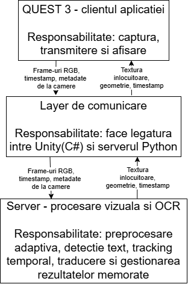
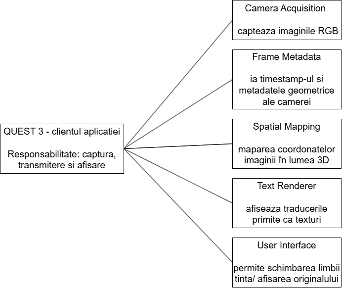
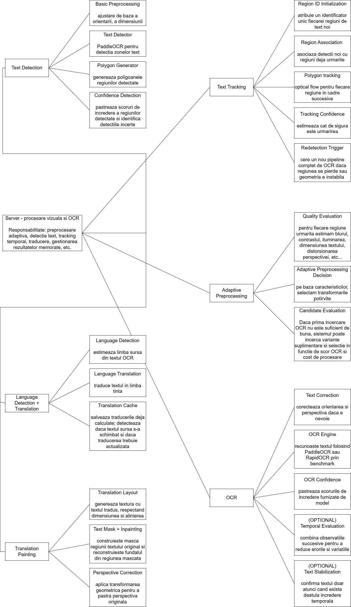
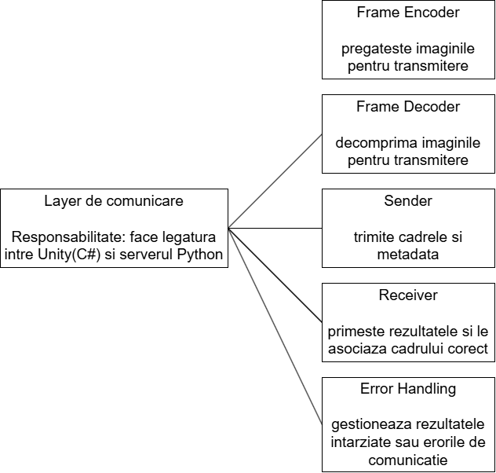
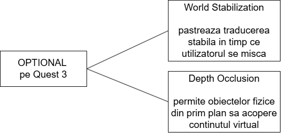

# Traducere automată a textului în timp real în realitate augumentată

Acest proiect are ca scop traducerea textului vizibil în realitate augmentată într-o limbă țintă.

La nivel hardware este folosit un dispozitiv **Meta Quest 3** care execută `clientul` și un **calculator** pentru execuția programului `server`.

## Arhitectura proiectului

<table cellpadding="6" width="100%">
  <tr>
    <td width="33%" align="center">
      
    </td>
    <td width="67%" align="center">
      
    </td>
  </tr>
</table>

<table cellpadding="6" width="100%">
  <tr>
    <td align="center">
      
    </td>
  </tr>
</table>

<table cellpadding="6" width="100%">
  <tr>
    <td width="55%" align="center">
      
    </td>
    <td width="45%" align="center">
      
    </td>
  </tr>
</table>

Clientul (realizat cu Unity în C#) codifică și trimite câmpul vizual al ochelarilor către server, împreună cu alte date necesare configurării sistemului și procesării spațio-temporale. 

Ulterior, preia de la server și decodifică imaginile procesate și trimise spre afișare.

Serverul (scris în Python) preia câmpul vizual al dispozitivului, înlocuiește segmentele de text observate cu segmente de text traduse, iar apoi codifică și trimite rezultatul spre afișare către client.

Comunicarea se realizează printr-o conexiune **TCP**, inițiată de client către adresa IP a calculatorului, pe portul **5000**. Imaginile sunt codificate în format **JPEG**, iar fiecare imagine este precedată de un antet de 4 octeți care indică dimensiunea datelor transmise. Clientul trimite un cadru și așteaptă rezultatul procesării înainte de a trimite următorul cadru, folosind aceeași conexiune pentru ambele sensuri de comunicare.

Procesarea efectivă a imaginilor se realizează printr-un pipeline format din 6 module:

1. Text Detection: efectuează transformări de bază aspura imaginii (precum corecția orientării), detectează zonele cu text și cuprinde fiecare secțiune cu poligoane, luând în calcul detecțiile incerte.

2. Text Tracking: identifică și urmărește în timp fiecare regiune, iar la pierderea sau modificarea radicală a unei regiuni cere recalcularea cu un pipeline complet de OCR.

3. Adaptive Preprocessing: estimează indicatori de calitate a imaginii (ex. contrastul, iluminarea) și aplică transformări de preprocesare potrivite pentru situație.

4. OCR: se fac posibile corecții de perspectivă, iar apoi textul se recunoaște de-a lungul unui interval de timp pentru a reduce erorile.

5. Language Detection + Translation: estimează limba sursă a textului și salvează traducerea în limba țintă la nivel de obiect.

6. Translation Painting: generează și aplică un overlay peste imaginea inițială cu textul tradus, în funcție de condițiile originale.

## Studiu asupra literaturii de specialitate și ale soluțiilor existente

Tabelul următor prezintă lucrări și proiecte relevante pentru recunoașterea optică a caracterelor, procesarea video și urmărirea obiectelor în realitate mixtă.

<table>
  <thead>
    <tr>
      <th>Nr.</th>
      <th>Autor(i) / An</th>
      <th>Titlul articolului / proiectului</th>
      <th>Aplicație / Domeniu</th>
      <th>Tehnologii utilizate</th>
      <th>Metodologie / Abordare</th>
      <th>Rezultate</th>
      <th>Limitări</th>
      <th>Comentarii suplimentare</th>
    </tr>
  </thead>
  <tbody>
    <tr>
      <td>1</td>
      <td>Pankaj Tripathi / 2025</td>
      <td>
        <strong>Text recognition algorithms: 10 methods behind modern OCR</strong>
      </td>
      <td>
        
Recunoașterea optică a caracterelor (OCR).

        
Digitizarea documentelor.

        
Detectarea textului în imagini naturale.

        
Recunoașterea scrisului de mână.

      </td>
      <td>
        
CTPN, EAST, CRAFT, DBNet.

        
CRNN, CTC, TrOCR, PARSeq.

        
Word Beam Search, LayoutLMv3 și Donut.

      </td>
      <td>
        
Preprocesarea imaginii.

        
Detectarea regiunilor de text.

        
Recunoașterea caracterelor și decodarea rezultatelor.

        

          Sunt comparate principiile de funcționare, avantajele,
          dezavantajele și scenariile de utilizare ale metodelor.
        

      </td>
      <td>
        
EAST este potrivit pentru detecție rapidă.

        
CRAFT este potrivit pentru text neregulat.

        
CRNN + CTC permite recunoașterea secvențelor de caractere.

        
Modelele Transformer precum TrOCR pot gestiona scrisul de mână.

      </td>
      <td>
        

          Performanța reală depinde de calitatea imaginilor,
          limbă, font, orientare, complexitatea fundalului
          și datele de antrenare.
        

      </td>
      <td>
        
Character Error Rate (CER).

        
Word Error Rate (WER).

        
Precizia detecției.

        
Timpul de procesare și memoria utilizată.

      </td>
    </tr>
    <tr>
      <td>2</td>
      <td>RapidAI Team</td>
      <td><strong>RapidOCR</strong></td>
      <td>
        

          Recunoașterea optică a textului (OCR) din imagini
          și documente, inclusiv în engleză și chineză.
        

      </td>
      <td>
        
Python.

        
ONNX Runtime.

        
OpenCV.

        
Modele PaddleOCR (PP-OCR).

      </td>
      <td>
        

          Utilizează modele preantrenate pentru detecția
          și recunoașterea textului, optimizate pentru inferență
          pe CPU prin ONNX Runtime.
        

        
Extrage textul, coordonatele și scorurile de încredere.

      </td>
      <td>
        

          Permite recunoașterea textului fără GPU dedicat,
          cu modele compacte și integrare relativ simplă
          în aplicații backend.
        

      </td>
      <td>
        

          Performanța depinde de calitatea imaginii, rezoluție,
          orientarea textului și modelul utilizat.
        

        

          Nu include implicit traducerea sau înlocuirea
          textului în imagine.
        

      </td>
      <td>
        

          Proiect open-source, fără articol științific propriu
          peer-reviewed identificat.
        

        

          Se bazează pe cercetările PaddleOCR,
          în special PP-OCR (Du et al., 2020).
        

      </td>
    </tr>
    <tr>
      <td>3</td>
      <td>Yuning Du et al. / 2020</td>
      <td><strong>PP-OCR: A Practical Ultra Lightweight OCR System</strong></td>
      <td>
        

          Recunoașterea optică a textului (OCR) din imagini,
          în special în engleză și chineză, pentru aplicații
          cu resurse computaționale limitate.
        

      </td>
      <td>
        
PaddlePaddle.

        
Deep Learning și CNN.

        
Modele lightweight pentru detecția și recunoașterea textului.

      </td>
      <td>
        
Detecția textului.

        
Clasificarea orientării.

        
Recunoașterea caracterelor.

        

          Utilizează tehnici de optimizare și compresie
          a modelelor pentru reducerea dimensiunii
          și îmbunătățirea acurateței.
        

      </td>
      <td>
        

          Sistem OCR ultra-lightweight, cu modele de doar
          3,5 MB pentru 6.622 caractere chinezești și 2,8 MB
          pentru 63 simboluri alfanumerice.
        

        

          Modele preantrenate open-source, validate experimental
          și pentru alte limbi.
        

      </td>
      <td>
        
Nu realizează traducerea sau înlocuirea textului în imagine.

        

          Performanța poate fi afectată de imagini neclare,
          text foarte mic și fundaluri complexe.
        

        

          Aceste limitări sunt relevante practic, dar nu sunt
          cuantificate în rezumatul articolului.
        

      </td>
      <td>
        

          Lucrare științifică disponibilă pe arXiv,
          care constituie fundamentul tehnologic al modelelor
          PP-OCR utilizate și de RapidOCR.
        

        
Codul și modelele sunt open-source.

      </td>
    </tr>
    <tr>
      <td>4</td>
      <td>Arrtourz / 2026</td>
      <td><strong>Quest Book Translator</strong></td>
      <td>
        

          Traducerea textului din cărți în realitate mixtă
          (Meta Quest 3).
        

      </td>
      <td>
        
Unity și C#.

        
YOLO.

        
Google Cloud Vision OCR.

        
Google Cloud Translation API.

      </td>
      <td>
        
Detectează continuu cărțile folosind YOLO local.

        
Capturează imaginea la cererea utilizatorului.

        
Extrage și traduce textul prin servicii cloud.

        
Afișează traducerea într-un panou 3D ajustabil.

      </td>
      <td>
        
Prototip funcțional demonstrat prin videoclipuri.

        
Detectare locală în timp real.

        
Captură la comandă.

        
Traducere afișată în spațiul virtual.

      </td>
      <td>
        
Necesită internet și servicii cloud cu posibile costuri.

        
Traducerea nu suprascrie textul original.

        
Sensibil la iluminare, focalizare și perspectivă.

      </td>
      <td>
        
Proiect open-source experimental, destinat Meta Quest 3/3S.

        

          Propune ulterior OCR local prin PaddleOCR,
          reconstruirea aspectului textului
          și detectarea schimbării paginii.
        

      </td>
    </tr>
    <tr>
      <td>5</td>
      <td>Mirela Domiciano / 2025</td>
      <td><strong>Image Pre-Processing Techniques for OCR</strong></td>
      <td>
        
Prelucrarea imaginilor digitale.

        
Îmbunătățirea documentelor scanate sau fotografiate.

        
Recunoașterea optică a caracterelor (OCR).

      </td>
      <td>
        
OpenCV.

        
Normalizare și redimensionare.

        
Conversie în tonuri de gri.

        
Binarizare adaptivă.

        
CLAHE pentru îmbunătățirea contrastului.

        
Filtre mediane și bilaterale pentru reducerea zgomotului.

        
Transformări geometrice pentru corectarea perspectivei.

      </td>
      <td>
        

          Sunt analizate individual și în combinații
          cele șapte operații de preprocesare.
        

      </td>
      <td>
        

          Articolul propune evaluarea compromisului
          dintre viteza procesării și acuratețea extragerii textului.
        

        

          Sunt definite metrici precum latența,
          timpul de execuție, numărul de câmpuri extrase corect,
          procentul de potriviri corecte și eficiența globală.
        

      </td>
      <td>
        

          Set de testare redus, de numai cinci imagini,
          ceea ce limitează generalizarea rezultatelor.
        

      </td>
      <td>
        

          Sursă relevantă pentru proiectarea unui pipeline
          de preprocesare înainte de OCR.
        

      </td>
    </tr>
    <tr>
      <td>6</td>
      <td>Nikolay Sapunov / 2026</td>
      <td><strong>PaddleOCR For Video - Text Detection Deep-Dive</strong></td>
      <td>
        

          Procesarea imaginilor și Computer Vision,
          cu accent pe OCR în fluxuri video.
        

      </td>
      <td>
        
PaddleOCR PP-OCRv5 și DBNet.

        
Clasificator de orientare și SVTR_LCNet.

        
OpenCV / FFmpeg.

        
ONNX Runtime, OpenVINO și TensorRT.

        
Tracking și agregare temporală.

      </td>
      <td>
        
1. Text Detection: localizarea regiunilor cu text.

        
2. Orientation Classification: corectarea orientării textului.

        
3. Text Recognition: identificarea caracterelor și obținerea textului.

      </td>
      <td>
        

          Modelul mobile poate procesa un cadru 1080p
          în aproximativ 60–90 ms pe procesor.
        

        

          Varianta server: aproximativ 30–60 ms pe GPU,
          în condițiile de testare specificate.
        

      </td>
      <td>
        
1. Motion blur cauzat de mișcarea camerei sau a obiectelor.

        
2. Rezoluția scăzută afectează recunoașterea caracterelor.

        
3. Procesarea fiecărui cadru poate suprasolicita CPU/GPU.

        
4. Recunoașterea poate varia între cadre consecutive.

      </td>
      <td>
        

          OCR-ul pentru video trebuie tratat ca proces temporal,
          nu ca succesiune de imagini independente.
        

      </td>
    </tr>
    <tr>
      <td>7</td>
      <td>Mikel Broström</td>
      <td>
        <strong>
          BoxMOT: Pluggable State-of-the-Art Multi-Object Tracking Modules
        </strong>
      </td>
      <td>
        

          Computer Vision și Multi-Object Tracking (MOT):
          identificarea și urmărirea consecventă a obiectelor
          între cadre consecutive.
        

      </td>
      <td>
        
Python și C++.

        
PyTorch și NumPy.

        
YOLO și Kalman Filter.

        
ReID (Re-identification).

      </td>
      <td>
        
1. Modelul de detecție localizează obiectele în fiecare cadru.

        
2. Tracking-ul estimează pozițiile și asociază detecțiile.

        
3. Sunt utilizate informații geometrice pentru asociere.

        
4. Fiecare obiect primește un ID menținut între cadre.

        

          5. Pot fi configurați algoritmi precum ByteTrack,
          BoT-SORT, StrongSORT, DeepOCSORT și OccluBoost.
        

      </td>
      <td>
        

          Repository-ul prezintă rezultate comparative
          pe seturi de date standard, folosind metrici
          precum HOTA, MOTA și IDF1.
        

        

          Valorile raportate depind de setul de date
          și configurația evaluată.
        

      </td>
      <td>
        
1. Nu este un sistem OCR și nu citește textul din imagini.

        
2. Depinde de calitatea detecției obiectelor.

        
3. Rezultatele depind de algoritm, model și parametri.

      </td>
      <td>
        

          BoxMOT permite urmărirea aceleiași regiuni de text
          în cadre succesive, atribuindu-i un ID
          și facilitând agregarea rezultatelor OCR.
        

      </td>
    </tr>
  </tbody>
</table>

## Atribuții

Modulul `unity/` a început ca o clonă a [`Unity-PassthroughCameraApiSamples`](https://github.com/oculus-samples/Unity-PassthroughCameraApiSamples).

Licența originală și mențiunile privind drepturile de autor sunt păstrate în `unity/`.
